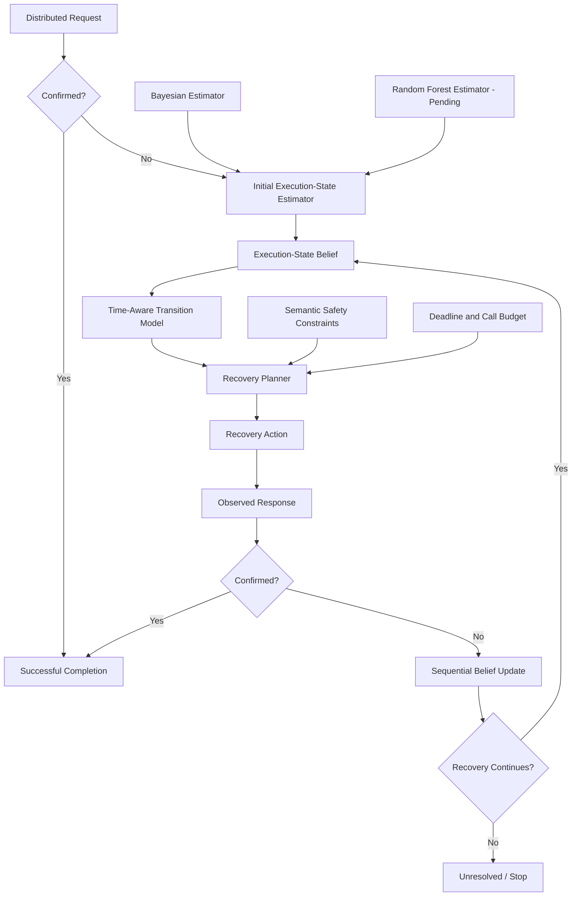
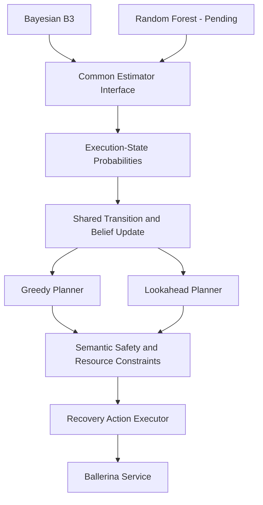

# SURE — Semantics-Constrained Uncertainty-Aware Recovery Engine

## Project Overview

SURE is a research-oriented fault recovery framework for distributed systems that combines probabilistic execution-state estimation, sequential belief updating, semantic safety constraints and resource-aware recovery planning.

The framework addresses ambiguous request failures, where a client cannot determine whether an operation has failed, is still processing or has already completed.

Rather than relying exclusively on predefined retry and backoff mechanisms, SURE evaluates possible recovery actions using probabilistic execution-state beliefs, observed responses, elapsed time, remaining deadlines and available recovery resources.

The project targets integration with the Ballerina programming language.

**Current Status:** Bayesian recovery prototype implemented, independently evaluated, packaged and integration tested. Random Forest integration and native Ballerina runtime implementation are pending.

---

## 1. Problem Statement

A communication failure in a distributed system does not necessarily indicate that the requested operation has failed.

Following a timeout or communication error, an operation may be:

- **Unstarted:** The operation has not begun execution.
- **Processing:** The operation is currently being executed.
- **Completed:** The operation has completed, but confirmation has not reached the client.

Conventional recovery mechanisms may introduce:

- Duplicate execution effects.
- Unnecessary recovery requests.
- Excessive waiting.
- Premature exhaustion of recovery resources.
- Increased recovery latency.
- Unresolved execution outcomes.

SURE investigates whether uncertainty-aware recovery planning can improve recovery effectiveness and resource utilization without violating operation semantics.

---

## 2. Research Objectives

- Estimate hidden execution states using observable client-side information.
- Investigate Bayesian and Random Forest probability estimators.
- Maintain execution-state beliefs throughout recovery.
- Model recovery-action outcomes and execution-state transitions.
- Incorporate elapsed time and recovery history into decision-making.
- Enforce mandatory semantic safety constraints.
- Optimize recovery under deadline and network-call restrictions.
- Compare greedy and bounded lookahead recovery strategies.
- Evaluate performance against conventional recovery mechanisms.
- Investigate performance under diverse and previously unseen fault conditions.
- Develop a reusable recovery framework targeting Ballerina.

---

## 3. System Architecture



### Core Components

| Component | Description | Status |
|---|---|---|
| Ballerina experimental service | Controlled distributed failure simulation | Complete |
| Bayesian fault estimator | Telemetry-based fault classification | Complete |
| Temporal Bayesian filter | Sequential fault probability estimation | Complete |
| Bayesian execution estimator | Initial request-level state probabilities | Complete |
| Random Forest estimator | Alternative initial probability estimator | Pending integration |
| Transition model | State, observation and duration prediction | Complete |
| Sequential belief updater | Updates execution-state probabilities | Complete |
| Semantic safety layer | Prevents inadmissible recovery actions | Complete |
| Greedy planner | Immediate expected-utility optimization | Complete |
| Lookahead planner | Bounded sequential recovery planning | Complete |
| Reusable Python recovery engine | Shared estimator and planning interface | Complete |
| Native Ballerina runtime | Native reusable recovery library | Pending |

---

## 4. Experimental Environment

Two Ballerina experimental services are available.

| Environment | Port | Purpose |
|---|---:|---|
| Original development service | 9090 | Initial model development and dataset collection |
| Extended evaluation service | 9091 | Independent recovery and robustness evaluation |

### Original Failure Conditions

- Normal execution.
- Lost response after execution.
- Dropped request.
- Slow execution.
- Slow status service.
- Unavailable status service.
- Unavailable primary endpoint.

### Extended Evaluation Environment

The extended service introduces:

- Variable processing delays.
- Simulated network delays and jitter.
- Intermittent primary and backup endpoint failures.
- Intermittent status-service failures.
- Request drops.
- Delayed responses.
- Combined failure conditions.
- Multiple initial timeout values.
- Multiple end-to-end deadlines.
- Different recovery-call budgets.
- Keyed and unkeyed operations.

An independent execution ledger records execution attempts, execution effects and server-side execution information.

Ground-truth ledger information is used for training labels and experimental verification, not as privileged input to the runtime recovery estimator.

The environment is a controlled single-process synthetic testbed rather than a production distributed deployment.

---

## 5. Bayesian Development

### B1 — Bayesian Fault Estimation

Initial fault classification experiments were conducted using the RCAEval dataset.

The selected data contains 125 experimental cases covering CPU, memory, network delay, packet loss and disk faults, together with nominal observations.

#### Dataset Preparation

| Property | Value |
|---|---:|
| Experimental cases | 125 |
| Raw telemetry observations | 262,603 |
| Prepared observation windows | 750 |
| Features per observation window | 48 |
| Training cases | 75 |
| Validation cases | 25 |
| Reserved test cases | 25 |

Gaussian Naive Bayes was implemented using common CPU and memory telemetry features.

Complete experimental cases were assigned to individual partitions to prevent leakage between observation windows belonging to the same case.

### B1.1 — Bayesian Model Optimization

The initial Bayesian classifier was improved using:

- Variance-smoothing optimization.
- Class-prior investigation.
- Temperature-based probability calibration.
- Fault-detection threshold selection.
- Probability-quality evaluation.

### B2 — Temporal Bayesian Filtering

Temporal Bayesian filtering was introduced to incorporate previous fault beliefs when interpreting new telemetry observations.

This substantially reduced false alarms compared with independent classification of observation windows.

#### Reserved-Test Results

| Metric | Static Bayesian Threshold | Temporal Bayesian Threshold |
|---|---:|---:|
| Accuracy | 68.00% | 90.67% |
| Balanced accuracy | 77.78% | 87.11% |
| Macro F1 | 70.45% | 87.57% |
| Log loss | 1.1925 | 0.8921 |
| Brier score | 0.5505 | 0.3868 |
| Nominal false-alarm rate | 46.67% | 4.00% |
| Fault detection recall | 94.67% | 94.67% |

The temporal model achieved 90.67% accuracy on 150 reserved observation windows from 25 cases.

B1 and B2 constitute supporting telemetry-based fault-estimation research. They are not directly integrated into the current live request-recovery engine.

---

## 6. B3 — Request-Level Bayesian Execution-State Estimation

RCAEval does not contain the request-level execution-state labels and recovery-action outcomes required for SURE.

A custom dataset was therefore generated using the Ballerina experimental service.

### Dataset Generation

| Property | Count |
|---|---:|
| Experimental episodes | 1,008 |
| Raw recovery samples | 864 |
| Quarantined samples | 54 |
| Validated recovery samples | 810 |
| Training samples | 405 |
| Validation samples | 201 |
| Reserved test samples | 204 |

Timestamp-boundary inconsistencies were investigated and uncertain state labels were quarantined.

### Runtime Input Features

- `error`
- `keyed`
- `initial_timeout_ms`

The estimator uses Dirichlet-smoothed conditional frequency estimates with additive smoothing.

The output is a probability distribution over:

```text
P(unstarted)
P(processing)
P(completed)
```

Privileged information such as injected failure mode, server-side execution state and future recovery outcomes is excluded from runtime estimator inputs.

### Reserved-Test Performance

| Metric | Global Prior Baseline | Bayesian B3 |
|---|---:|---:|
| Accuracy | 52.94% | 68.63% |
| Balanced accuracy | 33.33% | 51.11% |
| Macro F1 | 23.08% | 48.90% |
| Log loss | 1.0028 | 0.7946 |
| Brier score | 0.6021 | 0.4559 |

### Confusion Matrix

Rows represent actual execution states and columns represent predicted states.

| Actual / Predicted | Unstarted | Processing | Completed |
|---|---:|---:|---:|
| Unstarted | 32 | 0 | 28 |
| Processing | 0 | 0 | 36 |
| Completed | 0 | 0 | 108 |

B3 improves probability estimation compared with the global-prior baseline.

However, processing-state classification remains a limitation. Processing is not selected as the most probable class in the reserved test partition.

The recovery engine therefore maintains the full probability distribution instead of relying exclusively on hard state classifications.

---

## 7. B4 — Recovery Action Transition Model

The action transition model estimates the joint probability distribution of:

- Subsequent execution state.
- Recovery observation.
- Recovery-action duration.

The original model was conditioned on the current execution state, selected recovery action and deduplication support.

### Supported Recovery Actions

| Action | Purpose |
|---|---|
| Wait | Allow the operation to progress |
| Reconcile | Query authoritative execution status |
| Retry | Safely resubmit an operation |
| Failover | Contact an alternative endpoint under a verified safety contract |
| Stop | Terminate recovery |

Initial single-step experiments identified limitations in modelling natural execution completion and time-dependent transitions.

These findings motivated multi-step trajectory collection.

---

## 8. B4.1 — Time-Aware Transition Modelling

### Multi-Step Dataset Collection

| Dataset | Episodes | Usable Recovery Steps |
|---|---:|---:|
| Original single-step collection | 1,008 | 810 |
| Multi-step pilot | 189 | 481 |
| Expanded multi-step collection | 756 | 1,935 |

The expanded collection introduced:

- Sequential recovery trajectories.
- High-resolution duration measurements.
- Chronological action histories.
- Execution-state boundary auditing.
- Conservative label quarantine.
- Natural completion transitions during waiting.

The expanded dataset was divided into:

| Partition | Episodes | Usable Steps |
|---|---:|---:|
| Training | 378 | 967 |
| Validation | 189 | 481 |
| Reserved testing | 189 | 487 |

### Transition Model Variants

| Model | Conditioning Information |
|---|---|
| B4.0 | Execution state, action and deduplication |
| B4.1a | B4.0 plus elapsed time |
| B4.1b | B4.1a plus previous action and observation |

Hierarchical Bayesian backoff is used to handle sparse transition combinations.

### Reserved-Test Performance

The following results use sequential belief replay with the frozen B3 estimator.

| Metric | B4.0 | B4.1a | B4.1b |
|---|---:|---:|---:|
| Next-state accuracy | 79.88% | 81.72% | 81.72% |
| Observation accuracy | 81.31% | 83.16% | 83.37% |
| Joint log loss | 1.1079 | 1.0790 | 1.0740 |
| Next-state Brier score | 0.3020 | 0.2827 | 0.2777 |
| Confirmation Brier score | 0.0621 | 0.0586 | 0.0570 |
| Duration MAE | 33.09 ms | 32.58 ms | 32.36 ms |

B4.1b achieved approximately 8.04% lower next-state Brier error than the matched time-independent model.

Time-aware modelling improved probability prediction. The additional benefit of recovery-history conditioning was smaller.

B4.1b remains the frozen transition model for subsequent experiments.

The replay evaluation uses recorded actions and does not constitute counterfactual policy evaluation.

---

## 9. Sequential Bayesian Belief Updating

The recovery engine maintains a probability distribution over possible execution states throughout recovery.

After each recovery action:

1. Predict possible state transitions and observations.
2. Execute the selected permissible action.
3. Observe the response.
4. Update the execution-state belief.
5. Update elapsed time and remaining resources.
6. Evaluate the next recovery decision.

Unexpected observations are handled using a fallback to the predicted next-state distribution.

An unexpected observation is not treated as successful execution confirmation.

Observed action durations advance the elapsed-time context, although duration itself is not currently used as direct Bayesian observation evidence.

---

## 10. Semantic Safety Constraints

Semantic safety restrictions are enforced independently of probabilistic predictions.

| Action | Unkeyed Operation | Verified Keyed Operation |
|---|---|---|
| Wait | Allowed | Allowed |
| Reconcile | Allowed | Allowed |
| Stop | Allowed | Allowed |
| Retry after ambiguous failure | Blocked | Conditionally allowed |
| Failover after ambiguous failure | Blocked | Conditionally allowed |

A timeout or ordinary not-found response does not prove that an operation has not executed.

Retry and failover require appropriate execution guarantees, including shared deduplication protection across relevant endpoints.

Probability estimates cannot override mandatory safety restrictions.

The framework additionally enforces:

- End-to-end deadline restrictions.
- Recovery network-call budgets.
- Maximum recovery-step limits.
- Conservative action-admission rules.

These mechanisms are experimentally tested but do not constitute a formal production-grade safety proof or hard real-time guarantee.

---

## 11. Recovery Planning

### V2 — Bayesian Greedy Recovery

Evaluates the immediate expected utility of permissible recovery actions and selects the best available action.

Execution-state beliefs are updated following each observed response.

### V4 — Bayesian Bounded Lookahead Recovery

Evaluates possible future recovery actions and observations within a bounded planning horizon.

Lookahead can account for:

- Future execution confirmation.
- Benefits of obtaining additional information.
- Natural execution progress during waiting.
- Remaining recovery-call resources.
- Deadline restrictions.
- Future recovery opportunities.

### Recovery Objective

The planner maximizes expected confirmed-on-time completion reward while accounting for recovery network-call costs and time consumption.

Semantic restrictions remain mandatory rather than optional reward penalties.

### Frozen Planner Configuration

| Parameter | Value |
|---|---|
| Initial estimator | B3 Bayesian |
| Transition model | B4.1b |
| Greedy depth | 1 |
| Lookahead depth | 2 |
| Time-cost weight | 0.10 |
| Network-call cost | 0.025 |
| Waiting interval | 75 ms |
| HTTP action timeout | 180 ms |
| Action-admission margin | 25 ms |
| Maximum recovery steps | 4 |
| Independent recovery-call budgets | 1, 2, 3, 4 |
| Independent deadlines | 350, 750, 1,250 ms |
| Initial timeout values | 100, 150, 200 ms |

---

## 12. Development Experiments

Multiple development experiments were conducted before freezing the selected Bayesian configuration.

| Experiment | Matched Scenarios | Request Episodes |
|---|---:|---:|
| Initial planner pilot | 14 | 56 |
| Improved time-aware pilot | 14 | 98 |
| Planner sensitivity analysis | 42 | 714 |
| Extended-environment smoke test | 14 | 140 |

The sensitivity analysis investigated:

- Planning depths of 1, 2 and 3.
- Alternative time-cost weights.
- Time-independent transition models.
- Time-aware transition models.
- Time-and-history-aware transition models.
- Conventional retry, reconciliation and failover baselines.

The selected depth-two planner achieved 66.67% confirmed completion in the development sensitivity experiment.

Failover backoff achieved the same completion rate.

Among the 22 initially unsuccessful requests recovered by both methods, Bayesian lookahead achieved approximately 17.31% lower mean latency.

These development results were used for configuration selection and are distinct from independent evaluation results.

---

## 13. Independent Recovery Evaluation

The Bayesian configuration and experimental protocol were frozen before independent evaluation.

### Experimental Design

| Experimental Variable | Levels |
|---|---:|
| Fault families | 7 |
| Deduplication settings | 2 |
| Initial timeout settings | 3 |
| Deadline settings | 3 |
| Recovery-call budgets | 4 |
| Matched scenarios | 504 |
| Recovery policies | 10 |
| Total request episodes | 5,040 |

Fault schedules were generated using seeded configurations, and policy execution order was randomized within each matched scenario.

Separate policy runs can experience different actual timings despite matching configured conditions.

### Independent Evaluation Results

| Recovery Policy | Successful Requests | Completion Rate |
|---|---:|---:|
| Bayesian lookahead — time only | 235/504 | 46.63% |
| Bayesian lookahead — no time | 235/504 | 46.63% |
| Bayesian lookahead — time + history | 232/504 | 46.03% |
| Failover backoff | 230/504 | 45.63% |
| Bayesian greedy | 228/504 | 45.24% |
| Hybrid backoff | 209/504 | 41.47% |
| Retry backoff | 178/504 | 35.32% |
| Safe retry | 177/504 | 35.12% |
| Reconciliation backoff | 148/504 | 29.37% |
| Fixed reconciliation | 142/504 | 28.17% |

### Recovery of Initially Unconfirmed Requests

| Recovery Policy | Recovered Requests | Recovery Success |
|---|---:|---:|
| Bayesian lookahead | 169/441 | 38.32% |
| Failover backoff | 164/438 | 37.44% |
| Bayesian greedy | 163/439 | 37.13% |
| Hybrid backoff | 142/437 | 32.49% |

Initial outcomes varied slightly between separate policy runs, resulting in different denominators.

Confirmed completion is distinct from classification accuracy and actual server-side execution.

---

## 14. Statistical Evaluation

### Bayesian Lookahead vs Failover Backoff

| Metric | Result |
|---|---:|
| Lookahead completion rate | 46.03% |
| Failover backoff completion rate | 45.63% |
| Completion-rate difference | +0.40 percentage points |
| 95% success difference CI | -0.79 to +1.59 percentage points |
| McNemar exact p-value | 0.7539 |
| Lookahead wins | 6 |
| Failover backoff wins | 4 |
| Ties | 494 |

For the 160 initially unsuccessful requests recovered by both policies:

| Metric | Bayesian Lookahead | Failover Backoff |
|---|---:|---:|
| Mean end-to-end latency | 256.59 ms | 284.58 ms |

- Mean latency saved: **27.99 ms**
- Relative latency reduction: **9.83%**
- 95% paired bootstrap interval: **15.42–40.15 ms saved**

The latency advantage is conditional on both policies successfully recovering the request.

The completion-rate difference is not statistically significant. Statistical equivalence has not been established.

### Bayesian Lookahead vs Hybrid Backoff

| Metric | Result |
|---|---:|
| Completion improvement | +4.56 percentage points |
| Additional successful requests | 23 |
| Lookahead wins | 29 |
| Hybrid backoff wins | 6 |
| Ties | 469 |
| 95% success difference CI | +2.58 to +6.75 percentage points |
| McNemar exact p-value | 0.000117 |

Bayesian lookahead achieved a higher confirmed completion rate than hybrid backoff in this comparison.

This result does not independently isolate the contribution of lookahead.

### Bayesian Lookahead vs Bayesian Greedy

| Metric | Greedy | Lookahead |
|---|---:|---:|
| Completion rate | 45.24% | 46.03% |
| Successful requests | 228 | 232 |
| Average recovery calls | 0.982 | 0.974 |
| Average waiting actions | 0.000 | 0.333 |
| Mean decision overhead | 0.99 ms | 3.26 ms |

The completion difference was not statistically significant (McNemar p = 0.3877).

Among 159 commonly recovered requests, lookahead introduced an additional 37.33 ms mean latency.

These results identify a trade-off between sequential planning and immediate recovery efficiency.

### Transition Context Ablation

| Configuration | Completion Rate | Average Recovery Calls |
|---|---:|---:|
| Time-independent lookahead | 46.63% | 1.008 |
| Time-aware lookahead | 46.63% | 0.996 |
| Time-and-history-aware lookahead | 46.03% | 0.974 |

The selected time-and-history-aware planner achieved lower conditional latency than both simpler lookahead configurations, but did not improve aggregate completion rates.

All secondary comparisons and subgroup analyses should be interpreted with appropriate caution.

---

## 15. Robustness and Failure Analysis

Detailed recovery-trajectory analysis was performed following independent evaluation.

### Performance by Fault Family

| Fault Family | Greedy | Lookahead | Failover Backoff |
|---|---:|---:|---:|
| Normal | 72/72 | 71/72 | 71/72 |
| Response delay | 52/72 | 52/72 | 52/72 |
| Dropped requests | 28/72 | 27/72 | 28/72 |
| Endpoint failure | 33/72 | 33/72 | 33/72 |
| Status service failure | 39/72 | 38/72 | 39/72 |
| Slow execution | 3/72 | 8/72 | 7/72 |
| Combined faults | 1/72 | 3/72 | 0/72 |

Lookahead demonstrated its largest aggregate improvements over greedy under slow execution and combined faults.

Individual recovery traces demonstrated how waiting before reconciliation can preserve limited recovery-call resources.

These findings are exploratory rather than independently established subgroup superiority.

### Safety and Resource Verification

Across the 5,040 independent request episodes:

- Zero recorded duplicate execution effects.
- Zero recorded deadline overruns.
- No observed recovery-call budget violations.
- No observed maximum-step violations.
- No unsafe retry or failover dispatches in unkeyed recovery traces.

### Unexpected Observations

The selected lookahead configuration encountered 57 unexpected observation updates across 37 request episodes.

Most unexpected updates occurred under combined fault conditions.

The recovery engine continued using its conservative belief-update fallback.

### Unresolved Operations

For the 504 requests evaluated using the selected V4 configuration:

| Outcome | Count |
|---|---:|
| Confirmed on-time completion | 232 |
| Execution effect recorded but unconfirmed | 164 |
| No recorded execution effect | 108 |

Unconfirmed requests must not automatically be treated as failed executions.

### Long Execution Delays

None of the tested recovery policies successfully confirmed the 84 scenarios with configured processing durations exceeding 500 ms.

Some of these scenarios were inherently infeasible because processing alone exceeded the deadline.

Fixed waiting intervals, limited recovery steps, model mismatch and communication delays remain important restrictions.

---

## 16. Reusable Recovery Engine

The evaluated recovery algorithm was extracted into a reusable Python module while preserving the original frozen experimental implementation.

### Runtime Modules

| Module | Purpose |
|---|---|
| `sure/recovery_core.py` | Common recovery engine |
| `sure/recovery_estimators.py` | Bayesian estimator loading and RF adapter |
| `sure/recovery_http.py` | HTTP communication with the Ballerina fixture |
| `sure/independent_recovery.py` | Original independent experimental adapter |

The shared recovery engine supports interchangeable probability estimators.



The Random Forest adapter supports the expected probability interface, but integration with the collaborator's actual trained model remains pending.

---

## 17. Planned Comparative Configurations

| Version | Initial Estimator | Planner | Status |
|---|---|---|---|
| V2 | Bayesian | Greedy | Implemented and evaluated |
| V3 | Random Forest | Greedy | Pending RF integration |
| V4 | Bayesian | Bounded lookahead | Implemented and evaluated |
| V5 | Random Forest | Bounded lookahead | Pending RF integration |

All configurations will share:

- Transition and observation model.
- Sequential belief-updating mechanism.
- Semantic safety restrictions.
- Recovery-action executor.
- Deadline and resource restrictions.
- Experimental evaluation procedures.

This factorial comparison will investigate:

- The contribution of the initial probability estimator.
- The contribution of sequential recovery planning.
- The interaction between estimator quality and planning strategy.

V5 uses Random Forest for initial execution-state probabilities and the common Bayesian belief-update mechanism. It does not require a combined Bayesian/Random Forest classifier.

---

## 18. Testing and Verification

### Frozen-Model Unit Tests

Eight tests passed, covering:

- Frozen model integrity during setup.
- Execution-state ordering.
- Probability-distribution validity.
- Unkeyed operation safety.
- Recovery-call budget restrictions.
- Deadline restrictions.
- Transition probability mass.
- Unexpected-observation fallback.
- Planner action eligibility.

### Packaged Recovery Regression Tests

Six tests passed, including:

- 1,500 scripted policy parity comparisons.
- Recovery-decision consistency.
- Belief-update consistency.
- Recovery-trace consistency.
- Random Forest probability ordering.
- Invalid-input and confirmation validation.

### Live Integration Testing

The packaged engine was tested against the extended Ballerina service.

| Property | Result |
|---|---:|
| Matched scenarios | 14 |
| Recovery configurations | 2 |
| Live integration episodes | 28 |
| Greedy confirmations | 7/14 |
| Lookahead confirmations | 7/14 |
| Integration test result | Passed |

The live integration smoke test verifies implementation compatibility and is not an independent performance comparison.

---

## 19. Final Bayesian Performance Summary

| Metric | Result |
|---|---:|
| Temporal fault classification accuracy | 90.67% |
| Temporal fault classification macro F1 | 87.57% |
| Temporal fault false-alarm rate | 4.00% |
| Initial execution-state accuracy | 68.63% |
| Initial execution-state macro F1 | 48.90% |
| Next-state prediction accuracy | 81.72% |
| Recovery observation prediction accuracy | 83.37% |
| Independent matched scenarios | 504 |
| Independent request episodes | 5,040 |
| Selected lookahead completion rate | 46.03% |
| Recovery of initially unconfirmed requests | 38.32% |
| Conditional latency reduction vs failover backoff | 9.83% |
| Completion improvement vs hybrid backoff | +4.56 percentage points |
| Recorded duplicate execution effects | 0 |
| Recorded deadline overruns | 0 |
| Unit and regression tests passed | 14 |
| Scripted parity comparisons | 1,500 |
| Packaged live integration episodes | 28 |

The prediction metrics concern different tasks and must not be combined into a single system accuracy.

---

## 20. Repository Structure

Relevant Bayesian development and evaluation files:

```text
SURE_starter/
|
|-- ballerina_service/
|   |-- service.bal
|   `-- extended_service.bal
|
|-- ballerina_client/
|   `-- client.bal
|
|-- sure/
|   |-- __init__.py
|   |-- reference_service.py
|   |-- policy.py
|   |-- experiment.py
|   |-- independent_recovery.py
|   |-- recovery_core.py
|   |-- recovery_estimators.py
|   `-- recovery_http.py
|
|-- bayesian/
|   |-- audit_dataset.py
|   |-- prepare_rcaeval.py
|   |-- train_bayesian.py
|   |-- tune_bayesian.py
|   |-- temporal_bayesian.py
|   |-- collect_balanced.py
|   |-- train_execution_bayes.py
|   |-- train_action_kernel.py
|   |-- evaluate_bayesian_planner.py
|   |-- collect_multistep.py
|   |-- collect_multistep_v2.py
|   |-- train_time_aware_kernel.py
|   |-- evaluate_time_aware_planner.py
|   |-- evaluate_planner_sensitivity.py
|   |-- independent_evaluation.py
|   |-- score_frozen_holdouts.py
|   |-- check_packaged_recovery.py
|   |-- export_rf_handover.py
|   `-- outputs/
|
|-- data/
|
|-- tests/
|   |-- test_policy.py
|   |-- test_frozen_recovery.py
|   `-- test_recovery_core.py
|
|-- requirements.txt
|-- INDEPENDENT_README.txt
|-- PACKAGED_RECOVERY_README.md
|-- BAYESIAN_FINAL_README.md
|-- RF_HANDOVER.md
|-- .gitignore
`-- README.md
```

This structure describes the Bayesian component and relevant shared files rather than any separate Random Forest development branch.

---

## 21. Installation

### Requirements

- Python 3.
- Ballerina.
- NumPy.
- Pandas.
- Scikit-learn.
- Joblib.
- Requests.
- Dependencies specified in `requirements.txt`.

### Windows PowerShell Setup

```powershell
python -m venv .venv
.\.venv\Scripts\Activate.ps1
pip install -r requirements.txt
```

If the virtual environment already exists, activate it instead of recreating it.

### Start the Original Development Service

```powershell
bal run ballerina_service/service.bal
```

### Start the Extended Experimental Service

```powershell
bal run ballerina_service/extended_service.bal
```

Verify service availability:

```powershell
Invoke-RestMethod -Uri "http://127.0.0.1:9091/health"
```

Expected fixture identifier:

```text
sure_extended_v1
```

---

## 22. Experimental Reproduction

The following commands document the original development and evaluation pipeline.

Existing datasets, trained models and frozen experimental outputs should be preserved. Do not rerun data collection, training or evaluation into existing result directories without preparing a separate reproduction workspace.

### Request-Level Dataset Generation

```powershell
python -m bayesian.collect_balanced --repeats 8
```

### Bayesian Execution-State Training

```powershell
python -m bayesian.train_execution_bayes
```

### Original Transition Model

```powershell
python -m bayesian.train_action_kernel
```

### Initial Planner Evaluation

```powershell
python -m bayesian.evaluate_bayesian_planner --n 14
```

### Multi-Step Data Collection

```powershell
python -m bayesian.collect_multistep --repeats 1

python -m bayesian.collect_multistep_v2 --repeats 4
```

### Time-Aware Transition Model

```powershell
python -m bayesian.train_time_aware_kernel --b3 bayesian/outputs/b3/bayesian_b3.joblib
```

### Improved Planner Evaluation

```powershell
python -m bayesian.evaluate_time_aware_planner --n 14
```

### Sensitivity Analysis

```powershell
python -m bayesian.evaluate_planner_sensitivity --n 42
```

### Independent Evaluation

With the extended Ballerina fixture running:

```powershell
python -m bayesian.independent_evaluation verify

python -m bayesian.independent_evaluation smoke

python -m bayesian.independent_evaluation analyze-smoke

python -m bayesian.independent_evaluation freeze

python -m bayesian.score_frozen_holdouts

python -m bayesian.independent_evaluation run

python -m bayesian.independent_evaluation analyze
```

The original independent evaluation has already been completed.

The freeze and evaluation scripts protect existing experimental results against accidental overwriting.

---

## 23. Running Tests

### Frozen-Model Tests

```powershell
python -m unittest discover -s tests -p "test_frozen_recovery.py" -v
```

Expected:

```text
Ran 8 tests
OK
```

### Packaged Recovery Tests

```powershell
python -m unittest discover -s tests -p "test_recovery_core.py" -v
```

Expected:

```text
Ran 6 tests
OK
```

### Live Integration Smoke Test

Start the extended fixture before running:

```powershell
python -m bayesian.check_packaged_recovery
```

The original packaged smoke evaluation has already been completed. Preserve its output before attempting a fresh reproduction.

---

## 24. Random Forest Integration

The shared request-level dataset contains:

- 405 training samples.
- 201 validation samples.
- 204 reserved test samples.

The primary RF comparison must use the same features and partitions as B3.

### Export Development Data

```powershell
python -m bayesian.export_rf_handover
```

Expected output files:

```text
bayesian/outputs/rf_handover_v1/
|-- train.csv
|-- validation.csv
`-- manifest.json
```

The reserved test partition is intentionally excluded from the development export.

The Random Forest implementation should provide a fitted probability estimator supporting all three execution-state classes, together with reproducible training code and validation results.

The shared runtime adapter is available in `sure/recovery_estimators.py`.

See `RF_HANDOVER.md` for the complete training and integration contract.

---

## 25. Experimental Artifacts and Reproducibility

Important model and result directories:

```text
bayesian/outputs/
|
|-- b3/
|   |-- bayesian_b3.joblib
|   |-- recovery_validated.csv
|   |-- episode_splits.csv
|   `-- validation_metrics.json
|
|-- b41/
|   |-- kernel_tables.json
|   |-- episode_splits.csv
|   `-- validation_metrics.json
|
|-- planner_sensitivity/
|
|-- independent_smoke/
|
|-- independent_v1/
|   |-- protocol.json
|   |-- design.json
|   |-- holdouts/
|   `-- live/
|       |-- runs.csv
|       |-- summary.csv
|       |-- by_family.csv
|       |-- by_budget.csv
|       |-- by_deadline.csv
|       |-- by_keyed.csv
|       |-- by_initial_timeout.csv
|       |-- by_processing_range.csv
|       |-- initially_unconfirmed_summary.csv
|       |-- paired_analysis.json
|       `-- complete.json
|
|-- packaged_smoke/
|
`-- rf_handover_v1/
```

### Frozen Model SHA-256 Hashes

B3 Bayesian estimator:

```text
348174d885c1cf679687eff034c6942394651eef30f7b6466d2a0446ec18d3d8
```

B4.1 transition model:

```text
c71c371befcbfff09c751d8bdee65382b028cb594475f38006f517306367a3ad
```

The independent evaluation records frozen model hashes, source-code hashes and experimental design information.

Changes inspired by independent evaluation results must be treated as new research versions requiring fresh evaluation.

---

## 26. Research Findings

The completed Bayesian investigation provides evidence that:

1. Temporal Bayesian filtering improves telemetry-based fault estimation and substantially reduces false alarms.

2. Request-level Bayesian estimation improves probability prediction compared with a global-prior baseline.

3. Time-aware transition modelling improves next-state and observation prediction.

4. Sequential recovery planning can preserve limited recovery-call resources in individual scenarios.

5. Bayesian lookahead achieves lower conditional successful-recovery latency than conventional failover backoff in the independent synthetic evaluation.

6. Bayesian lookahead achieves a higher confirmed completion rate than hybrid backoff in the tested environment.

7. Lookahead introduces computational overhead and can be slower than greedy recovery.

8. Overall lookahead superiority over greedy recovery or failover backoff in completion rate has not been established.

9. Semantic safety restrictions prevented recorded inadmissible actions and duplicate execution effects within the evaluated testbed.

The results demonstrate useful recovery trade-offs rather than universal superiority over conventional recovery mechanisms.

---

## 27. Current Limitations

- Imperfect initial execution-state probability estimation.
- Processing-state classification weakness in B3.
- Limited runtime observability of hidden execution states.
- Synthetic single-process experimental environment.
- Dependence on the training failure distribution.
- Sparse transition observations for some recovery conditions.
- Limited performance under long processing delays.
- Fixed waiting interval and maximum recovery-step count.
- Higher planner computational overhead.
- Unexpected observations under combined faults.
- Conditional latency comparisons rather than unconditional latency guarantees.
- No formal proof of semantic safety.
- No guaranteed hard wall-clock deadline enforcement.
- No production-environment generalization evidence.
- Random Forest integration pending.
- Native Ballerina recovery library pending.

Reserved dataset records were previously included in descriptive audits. Their prediction scores were reserved from model selection, but the data was not completely blinded.

The reported statistical results apply to the evaluated synthetic design and should not be generalized directly to production systems.

---

## 28. Development Roadmap

### Completed Bayesian Component

- [x] Ballerina experimental service.
- [x] Distributed failure simulation.
- [x] Independent execution-ledger verification.
- [x] RCAEval dataset auditing.
- [x] Bayesian fault classification.
- [x] Probability calibration and tuning.
- [x] Temporal Bayesian filtering.
- [x] Request-level dataset generation.
- [x] Execution-state label validation.
- [x] Bayesian execution-state estimation.
- [x] Single-step transition modelling.
- [x] Multi-step trajectory collection.
- [x] Time-aware transition modelling.
- [x] Hierarchical Bayesian backoff.
- [x] Sequential belief updating.
- [x] Semantic safety restrictions.
- [x] Deadline and call-budget restrictions.
- [x] Greedy recovery planner.
- [x] Bounded lookahead planner.
- [x] Conventional recovery baselines.
- [x] Sensitivity analysis.
- [x] Transition-context ablation.
- [x] Extended experimental environment.
- [x] Frozen experimental protocol.
- [x] Reserved-test model evaluation.
- [x] Independent evaluation across 5,040 episodes.
- [x] Statistical analysis.
- [x] Robustness and recovery-trace analysis.
- [x] Reusable Python recovery engine.
- [x] Common estimator interface.
- [x] Random Forest probability adapter.
- [x] Frozen-model unit tests.
- [x] Packaged regression and parity tests.
- [x] Live Ballerina integration tests.
- [x] Bayesian technical documentation.

### Remaining Shared Project Work

- [ ] Verify RF development dataset export.
- [ ] Integrate trained Random Forest estimator.
- [ ] Evaluate RF on the shared reserved partition.
- [ ] Conduct V2/V3/V4/V5 integration testing.
- [ ] Conduct fresh factorial comparative experiments.
- [ ] Analyze estimator and planning-strategy interaction.
- [ ] Implement native Ballerina recovery runtime.
- [ ] Conduct native-library regression and integration testing.
- [ ] Complete final research documentation.
- [ ] Prepare research publication.

### Potential Future Extensions

- Adaptive waiting durations.
- Adaptive planning depth.
- Additional observable execution-state features.
- Improved handling of unexpected observations.
- More realistic distributed network-fault injection.
- Multi-service deployment experiments.
- Stronger semantic safety verification.

These extensions constitute potential new research versions and are not included in the frozen evaluation results.

---

## 29. Technical Documentation

Additional documentation:

- `BAYESIAN_FINAL_README.md` — Bayesian development and evaluation details.
- `INDEPENDENT_README.txt` — Independent experimental protocol.
- `PACKAGED_RECOVERY_README.md` — Reusable recovery engine usage.
- `RF_HANDOVER.md` — Random Forest training and integration requirements.

---

## Project Status

**Bayesian research prototype: Complete and tested.**

The Bayesian component includes trained probabilistic estimators, time-aware transition modelling, sequential belief updating, resource-aware recovery planning, semantic safety enforcement, independent experimental evaluation and reusable runtime implementation.

**Current project phase:** Random Forest integration and preparation for native Ballerina runtime implementation.

The overall research project is ongoing.
